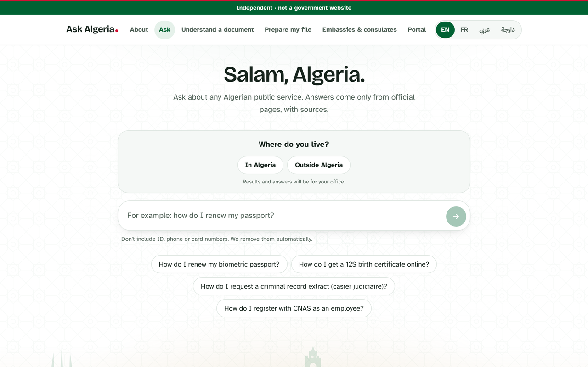
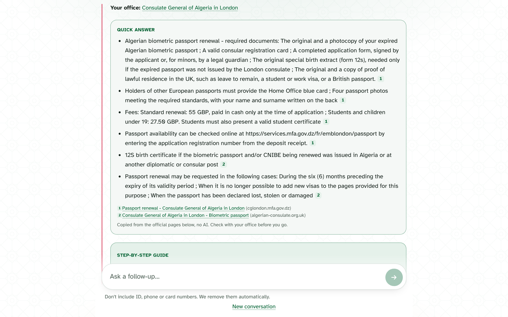
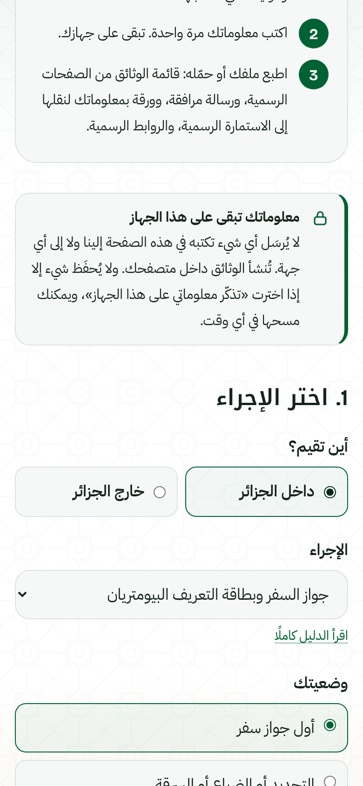

<div align="center">

# Ask Algeria

**Plain answers about Algerian public services, taken only from official pages.**
English · Français · العربية · الدارجة

[algeriagov.online](https://www.algeriagov.online) (private demo, password protected)

</div>

> **Independent project. Not a government website.** Ask Algeria is not affiliated with, endorsed by or run by the Government of Algeria or any ministry, wilaya or public body. It cannot submit applications or look up anyone's records.



## Why

Getting a passport, a 12S birth certificate or a criminal record extract usually means visiting several ministry and consulate websites. Many are only in French or Arabic, some are hard to reach from outside Algeria, and two consulates can list different rules for the same procedure. People end up queuing at an office just to ask which papers to bring.

Ask Algeria puts that information in one place. You say where you live, ask in your own words, and get the facts for **your** office with a link to every official page they came from.

## What it does

| | |
|---|---|
| **Ask** | Asks where you live first (a wilaya in Algeria, or a country and consulate abroad), then answers for your office. The first answer is free search: the facts themselves, quoted and cited, plus step-by-step guides and official pages. A written AI answer is one tap away for harder questions and follow-ups. |
| **Understand a document** | Paste text or upload a PDF or photo of an official letter. You get a translation or a plain-language summary with what to do next. Nothing is stored. |
| **Prepare my file** | Choose inside or outside Algeria and the procedure, type your details once, then print or download a zip with the document checklist, a cover letter, a details sheet to copy onto the official form, and the official links. Your details never leave your browser. |
| **Embassies & consulates** | 146 Algerian missions in 104 countries: addresses, phones, hours and appointment links, each with its source. |
| **Portal status** | Whether the main government portals are working, as checked from inside Algeria by our tester and automatically from our server. |
| **Glossary, directory, guides** | Admin words explained (12S, CNIBE, casier judiciaire…), 228 official sites by category, and cited step-by-step guides for the most common procedures. |



<p align="center"></p>

## How answers stay accurate

- **Official sources only.** The search covers about 1,150 pages and PDFs from .gov.dz, .dz and consulate sites. Every fact shown links to the page it came from. If the pages don't cover something, the site says so and points to the right office.
- **Your office first.** Rules differ between consulates (photos, fees, payment). Results favour your own office's pages, and another consulate's rules are labelled as such.
- **Four languages, both ways.** Synonyms link English, French, Arabic, Darija and Arabizi ("passeport", "جواز السفر", "باسبور", "paspor"), so a question in Darija finds a French ministry page.
- **Kept current.** A weekly job re-checks every page, refreshes those that changed, retires dead ones and flags facts that disagree between official sources. A tester in Algeria checks the sites that block foreign visitors.

## Built to be cheap to run

Most visitors never trigger an AI call: the first answer comes from free search. Claude (Haiku 5.5) runs only for a written answer, a follow-up or a document translation, and common answers are cached and shared.

Spending guards:
- a kill switch (`AI_DISABLED=1`), under which free search, guides and cached answers keep working;
- a daily budget across all servers;
- a per-visitor daily quota and a page cap on uploaded PDFs;
- a monthly spend limit on the API account.

Details and per-request costs are in [docs/cost.md](docs/cost.md).

## Tech

Next.js 16 (App Router, React 19) · TypeScript · Tailwind · Anthropic SDK · MiniSearch · Upstash Redis (optional) · Vercel

## Run it locally

```bash
npm install
cp .env.example .env.local   # set SITE_PASSWORD, plus ANTHROPIC_API_KEY or MOCK_LLM=1
npm run dev                  # http://localhost:3000
```

`MOCK_LLM=1` runs everything without an API key: free search, guides and Prepare my file are real, and AI answers are canned.

```bash
npm test                     # vitest (unit tests + search quality gate)
npm run lint && npm run typecheck
npm run build                # also rebuilds the search index
```

## Configuration

| Variable | | Purpose |
|---|---|---|
| `ANTHROPIC_API_KEY` | required* | Claude API key (*not needed with `MOCK_LLM=1`) |
| `SITE_PASSWORD` | required* | Password for the private demo (*not used once `PUBLIC_SITE=1`) |
| `PUBLIC_SITE` | optional | `1` = public launch: no password, indexable by search engines (redeploy after changing) |
| `AUTH_SECRET` | optional | Separate cookie-signing key; rotate it to sign everyone out. Also keys the hashed IPs (or set `IP_HASH_SECRET`) |
| `AI_DISABLED` | optional | `1` turns off every AI call |
| `AI_DAILY_BUDGET_USD` | optional | Daily AI budget across all servers (default 5) |
| `AI_DAILY_PER_IP`, `TRANSLATE_DAILY_PER_IP` | optional | Daily quotas per visitor (defaults 40 and 10) |
| `KV_REST_API_URL`, `KV_REST_API_TOKEN` | optional | Upstash Redis for the shared budget, quotas and answer cache (added automatically by the Vercel integration) |
| `FEEDBACK_WEBHOOK_URL` | optional | Forwards feedback and contact messages (for example, to a Google Sheet) |
| `CONTACT_EMAIL` | optional | Shows a contact email on the About page |
| `APIFY_TOKEN` | crawl only | Used by `npm run crawl` to fetch new official pages |

## Data

| File | Contents |
|---|---|
| `data/corpus.json` | The official pages that are searched |
| `data/sources.json` | Official sites, categories and tester notes |
| `data/missions.json` | Embassies and consulates |
| `lib/guides/` | Step-by-step guides; every point cites corpus pages (checked by tests) |

To refresh the data: `npm run refresh` (check pages, cross-check facts, rebuild the index). The GitHub Action in `.github/workflows/refresh.yml` does this every Monday and opens a pull request. The crawler for running from inside Algeria is described in [docs/algeria-developer-guide.md](docs/algeria-developer-guide.md).

## Privacy

- ID, phone and card numbers are removed in the browser before a question is sent, and again on the server.
- No accounts, no database of conversations. Uploaded documents are used for one request and never saved.
- Prepare my file builds every document in the browser; nothing typed there is sent anywhere.
- The full privacy notice, terms and legal notice are on [/legal](https://www.algeriagov.online/legal).

## Project layout

```
app/(site)/     pages: ask, translate, prepare, embassies, status, glossary, directory, services, about
app/api/        search (free), ask (AI), translate, status, feedback, login, logout
components/     page UIs (AskClient, PrepareClient, …)
lib/            search, synonyms, quick answers, guides, offices, spending guard, i18n
data/           pages, sources, missions, search index
scripts/        crawl, import, refresh, cross-check
tests/          vitest
```

## Monitoring

- `.github/workflows/uptime.yml` checks the site every 10 minutes through `/api/health`, which runs a real search, reports whether written AI answers are working (for example, out of API credit) and checks the TLS certificate. A failed run emails the owner.
- `/api/health?days=7` adds daily usage counts (searches, written answers, cache hits, blocks, AI errors) for the daily metrics check. No visitor data and no spend figures.

## License

All rights reserved. The code is public to show how the project is built, not for reuse: see [LICENSE](LICENSE).

## Credits and contact

Inspired by [Ask Pakistan](https://pakistangov.online/). Feedback, corrections and ideas are welcome through the contact form on the [About page](https://www.algeriagov.online/about#contact).
